  

  <strong>Python · Flask · SQLite · Practical Web Projects</strong>

  <a href="https://github.com/abubakartech11-ui?tab=repositories">Explore my repositories</a>

## About me

I'm **Abubakar**, a BS Artificial Intelligence student building practical applications with Python and Flask. I enjoy learning how software and AI can solve everyday problems.

- Building Python applications and web projects.
- Developing **ServiceHub**, a local service management platform.
- Exploring AI fundamentals, intelligent agents, and search algorithms.
- Learning API development with **FastAPI**.
- Serving as an **IEEE society event coordinator**.

## Technologies

| Area | Technologies |
| --- | --- |
| Programming | Python |
| Backend | Flask |
| Database | SQLite |
| Web | HTML, CSS, JavaScript |
| Editor | Visual Studio Code |
| Currently exploring | FastAPI, AI application development |

## Project work

### Learning Management System
A Flask application for student records, attendance, marks, and dashboard summaries.

**Built with:** Python · Flask · SQLite

### ATM Application
A Python and Flask project with balance checks, deposits, withdrawals, and PIN changes.

**Built with:** Python · Flask

### ServiceHub — in development
A local service management platform connecting customer requests with technician workflows.

**Focus:** Service requests · Technician workflows · Appointments · Reviews

## Current focus

---

<em>Learning through practice. Building with purpose.</em>

